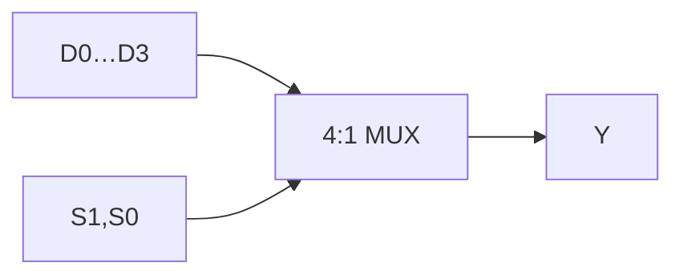
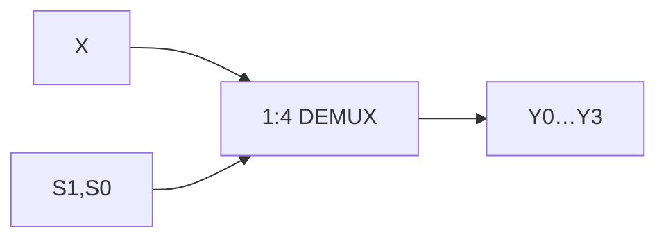

<ChapterHeader number="03" />

# Combinational Circuits

현재 입력만으로 출력을 정하는 선택·변환 회로입니다.

선수 지식: 진리표, AND/OR/NOT, Boolean 식입니다.

- MUX/DEMUX와 encoder/decoder의 방향을 구분할 수 있습니다.
- 4:1 MUX의 선택표를 Boolean 식으로 변환할 수 있습니다.
- comparator와 경로 지연을 계산하고 동치성을 확인할 수 있습니다.

<!-- Source: Harris & Harris, DDCA, 2nd ed., Ch. 2 and Ch. 5. -->

---

# 4:1 Multiplexer

| S1 S0 | Y |
| --- | --- |
| 00 | D0 |
| 01 | D1 |
| 10 | D2 |
| 11 | D3 |

선택 입력은 2 bits, 데이터 입력은 각각 1 bit입니다.

$$
\begin{aligned}
Y={}&\overline S_1\overline S_0D_0\\
&+\overline S_1S_0D_1\\
&+S_1\overline S_0D_2\\
&+S_1S_0D_3
\end{aligned}
$$

선택 신호를 decode한 뒤 각 D를 AND하고 OR합니다.

---

# MUX, DEMUX & Decoder

- **MUX:** 여러 입력 중 하나를 출력으로 선택합니다.
- **DEMUX:** 입력 X를 선택한 출력에 전달하고 나머지는 0으로 둡니다.
- **2:4 decoder:** $Y_0=\overline S_1\overline S_0$, $Y_1=\overline S_1S_0$, $Y_2=S_1\overline S_0$, $Y_3=S_1S_0$입니다.

> Active-high enable E가 있으면 각 출력에 E를 AND합니다. DEMUX는 decoder 출력에 X를 AND한 구조입니다.

---

# Encoder & Priority Encoder

일반 4:2 encoder는 one-hot 입력을 가정합니다. 여러 입력이 1이면 모호합니다.

| D3 D2 D1 D0 | Valid | Priority code Y1 Y0 |
| --- | ---: | --- |
| 1xxx | 1 | 11 |
| 01xx | 1 | 10 |
| 001x | 1 | 01 |
| 0001 | 1 | 00 |
| 0000 | 0 | 00 (무효 코드) |

이 priority encoder는 **D3가 최우선**입니다. x는 이 표에서 0 또는 1입니다.

> 코드 00만으로는 D0 선택과 입력 없음이 구분되지 않습니다. Valid를 함께 사용합니다.

---

# Magnitude Comparator

2-bit unsigned $A=A_1A_0$, $B=B_1B_0$를 비교합니다.

$$
E_i=\overline{A_i\oplus B_i},\qquad A=B\iff E_1E_0=1
$$

$$
A>B=A_1\overline B_1+E_1A_0\overline B_0
$$

상위 비트가 같을 때만 하위 비트를 비교합니다.

예: A=10, B=01 → $A_1\overline B_1=1$이므로 A>B입니다.

> 이 식은 unsigned 비교입니다. 같은 패턴을 signed로 읽으면 −2<+1입니다.

---

# Equivalence & Propagation Delay

2:1 MUX: $Y=\overline SD_0+SD_1$입니다.

| S | D0 D1 | Y |
| --- | --- | --- |
| 0 | 00 / 01 / 10 / 11 | 0 / 0 / 1 / 1 |
| 1 | 00 / 01 / 10 / 11 | 0 / 1 / 0 / 1 |

교육용 지연 가정: NOT=1 ns, AND=2 ns, OR=2 ns입니다.

- S → NOT → AND → OR: **5 ns**입니다.
- D → AND → OR: **4 ns**입니다.

> 이 값은 계산 연습용입니다. 라이브러리·부하·배선·입력 slew를 반영한 측정값이 아닙니다.

---

# Check Your Selection

1. 4:1 MUX에서 S=10, D0…D3=0,1,1,0이면 Y는 무엇인가요?
2. Priority 입력이 0110이면 Valid와 code는 무엇인가요?
3. MUX의 선택 신호와 데이터가 함께 바뀌면 항상 무글리치인가요?

**검산:** Y=D2=1 / Valid=1, code=10 / 아닙니다.

서로 다른 경로의 지연 때문에 과도 출력이 생길 수 있습니다. 안정된 진리표는 전이 중의 동작을 보장하지 않습니다.

