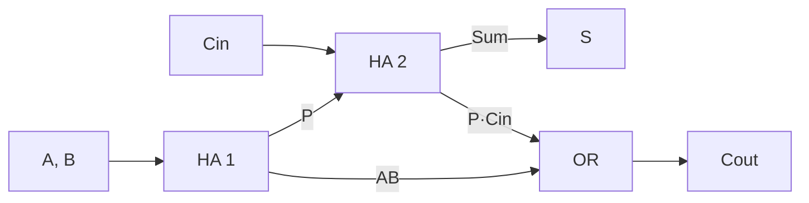

<ChapterHeader number="05" />

# Adders & Arithmetic Circuits

한 비트의 carry 규칙에서 여러 비트의 산술 회로를 만듭니다.

선수 지식: XOR, AND/OR, bit width와 signed overflow입니다.

- Half/full adder의 식과 진리표를 검증할 수 있습니다.
- Ripple carry와 carry lookahead의 경로를 설명할 수 있습니다.
- 4-bit 덧셈의 carry와 signed overflow를 구분할 수 있습니다.

<!-- Source: Harris & Harris, DDCA, 2nd ed., Ch. 5. Propagate uses XOR consistently. -->

---
routeAlias: op-half-full
clicks: 2
class: operation-slide
---

# Half Adder → Full Adder

Half adder: $S=A\oplus B$, $C=AB$입니다. Carry 입력은 없습니다.

A=1, B=1이면 정수 합은 2, 즉 **Carry=1, Sum=0**입니다.

Full adder는 두 half adder와 OR로 만들 수 있습니다.

$$
P=A\oplus B,\quad S=P\oplus C_{in},\quad C_{out}=AB+PC_{in}
$$

---

# Full Adder: Eight Cases

| A | B | Cin | Sum | Cout |
| --- | --- | --- | --- | --- |
| 0 | 0 | 0 | 0 | 0 |
| 0 | 0 | 1 | 1 | 0 |
| 0 | 1 | 0 | 1 | 0 |
| 0 | 1 | 1 | 0 | 1 |
| 1 | 0 | 0 | 1 | 0 |
| 1 | 0 | 1 | 0 | 1 |
| 1 | 1 | 0 | 0 | 1 |
| 1 | 1 | 1 | 1 | 1 |

각 행에서 정수 등식 $A+B+C_{in}=2C_{out}+S$가 성립합니다.

---
routeAlias: lab-adder
class: lab-slide
---

# Full Adder Simulator

입력 3개를 토글하여 이전 진리표의 모든 행을 재현하세요.

<FullAdderSimulator />

---
routeAlias: op-ripple
clicks: 6
class: operation-slide
---

# Four-bit Ripple Carry

<RippleCarryDemo :step="$clicks" />

---
routeAlias: eq-carry
clicks: 3
class: equation-slide
---

# Generate & Propagate

$g_i=A_iB_i$, $p_i=A_i\oplus B_i$로 정의합니다.

$$
c_{i+1}=g_i+p_ic_i,\qquad S_i=p_i\oplus c_i
$$

$$c_1=g_0+p_0c_0$$

$$c_2=g_1+p_1g_0+p_1p_0c_0$$

$$c_3=g_2+p_2g_1+p_2p_1g_0+p_2p_1p_0c_0$$

Ripple: c₀ → c₁ → c₂CLA: g₁,p₁,g₀,p₀,c₀ → c₂

Carry lookahead는 이전 carry를 순서대로 기다리는 대신 입력의 generate/propagate로 식을 전개합니다.

> 넓은 AND/OR의 fan-in, 배선, 부하 비용이 있습니다. 실제 구현은 계층형이나 prefix 구조를 사용할 수 있습니다.

---

# Delay, Area & Overflow

교육용 ripple 모델: 각 carry stage 지연을 $t_c$로 두면
$c_0\rightarrow c_4$ 경로 지연은 $4t_c$입니다.

| Structure | Advantage | Cost |
| --- | --- | --- |
| Ripple | 규칙적인 연결, 작은 기본 구조 | 긴 carry chain |
| Lookahead/prefix | carry 경로 깊이 감소 가능 | 추가 논리·배선·fan-out |

Signed overflow는 **MSB로 들어간 carry와 나온 carry의 XOR**입니다.

$$V=c_3\oplus c_4\quad\text{(4-bit)}$$

앞선 0111+0001은 $c_3=1,c_4=0$이므로 V=1입니다.

---
routeAlias: quiz-ch05
clicks: 2
class: quiz-slide
---

# Check Your Arithmetic

<QuizReveal :step="$clicks">

1. A=1, B=0일 때 Cin=1이면 Sum/Cout은 무엇인가요?
2. 4-bit `1111 + 0001`에서 결과, unsigned carry, signed overflow를 구하세요.
3. Lookahead가 모든 공정과 bit width에서 항상 더 빠른가요?

<template #answer>

**검산:** Sum=0, Cout=1 / 결과 0000, C=1, V=0 / 아닙니다.

</template>
<template #explanation>

속도 비교는 매핑된 셀, 배선, 부하와 제약을 포함해야 합니다. 논리 깊이만으로 최종 지연을 단정하지 않습니다.

</template>
</QuizReveal>
