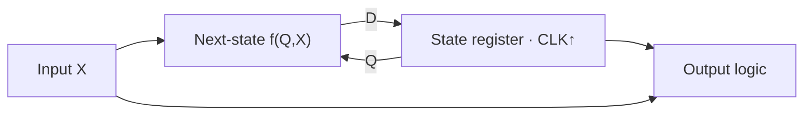

<ChapterHeader number="07" />

# Sequential Circuits

현재 상태와 입력으로 다음 상태를 정합니다.

선수 지식: D FF, 조합논리, unsigned 덧셈입니다.

- State register와 next-state logic을 분리할 수 있습니다.
- 2-bit counter와 shift register의 상태를 추적할 수 있습니다.
- Synchronous/asynchronous reset의 동작 시점을 비교할 수 있습니다.

<!-- Source: Harris & Harris, DDCA, 2nd ed., Ch. 3. Reset deassertion requires recovery/removal analysis. -->

---

# State Register & Next-state Logic

$$Q[k+1]=f(Q[k],X[k])$$

Register가 과거 정보를 보존하고 조합논리가 다음 상태를 계산합니다.

> 같은 에지의 모든 FF는 에지 직전 상태를 기준으로 갱신합니다. Q가 순서대로 즉시 바뀌는 소프트웨어 변수 모델과 구분하세요.

---

# Two-bit Synchronous Counter

Reset 후 Q=00이며, enable E=1인 상승 에지마다 mod-4 증가합니다.

| Q1 Q0 | Next (E=1) | Next (E=0) |
| --- | --- | --- |
| 00 | 01 | 00 |
| 01 | 10 | 01 |
| 10 | 11 | 10 |
| 11 | 00 | 11 |

$$D_0=Q_0\oplus E,\qquad D_1=Q_1\oplus(EQ_0)$$

예: Q=01, E=1이면 두 FF가 동시에 갱신되어 10이 됩니다.

---

# Synchronous vs Asynchronous Reset

여기서는 **active-high RST**, 상승 에지 FF입니다.

| Event | Synchronous reset | Asynchronous reset |
| --- | --- | --- |
| RST=1, CLK 에지 없음 | 아직 변화 없음 | 에지 없이 Q=0 |
| CLK↑, RST=1 | Q=0 | Q=0 유지 |
| RST 해제 | 다음 에지에서 일반 동작 | recovery/removal 고려 |

동기 reset은 다음 상태 식에 포함됩니다: $D=RST?0:f(Q,X)$.

비동기 assertion 후 **각 clock domain에서 deassertion을 동기화**하는 구조를 자주 사용합니다.

> Reset 극성·우선순위·최소 pulse width·해제 조건을 명세해야 합니다.

---

# Counter State Trace

초기 Q=00, synchronous RST가 enable보다 우선합니다.

| Rising edge k | RST | E | Q before | Q after |
| --- | --- | --- | --- | --- |
| 1 | 1 | 1 | 00 | 00 |
| 2 | 0 | 1 | 00 | 01 |
| 3 | 0 | 1 | 01 | 10 |
| 4 | 0 | 0 | 10 | 10 |
| 5 | 0 | 1 | 10 | 11 |
| 6 | 0 | 1 | 11 | 00 |

RST가 edge 3과 4 사이에서만 잠깐 1이 되면 동기 reset은 놓칠 수 있습니다.

---

# Shift Register

4-bit right shift: $Q^+=\{serial\_in,Q_3,Q_2,Q_1\}$입니다.

| Edge | Serial input | Q after |
| --- | --- | --- |
| 초기 | — | 0000 |
| 1 | 1 | 1000 |
| 2 | 0 | 0100 |
| 3 | 1 | 1010 |
| 4 | 1 | 1101 |

기존 Q0가 serial output으로 빠져나갑니다. 입력 비트는 높은 위치부터 이동합니다.

> 시프트 방향과 새 bit의 삽입 위치를 반드시 함께 적으세요.

---

# Design & Check a Sequence

설계 절차: **명세 → 상태/폭 → 전이표 → 식 → reset → 검증**입니다.

1. Counter가 E=0에서 상태를 유지하는지 식으로 확인하세요.
2. 초기 Q=1010, serial_in=1인 right shift 결과는 무엇인가요?
3. 비동기 reset이면 해제 시점도 timing과 무관한가요?

**검산:** $D_0=Q_0$, $D_1=Q_1$ / 1101 / 아닙니다.

상태 trace는 reset, enable 정지, wraparound 같은 경계 동작까지 포함해야 합니다.

