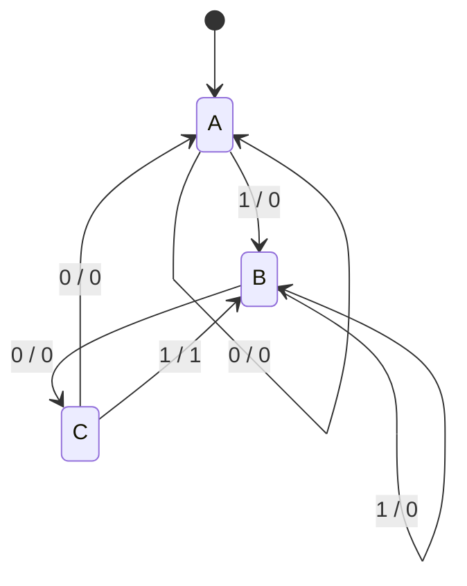

<ChapterHeader number="08" />

# Finite State Machines

Moore와 Mealy로 겹침을 허용하는 101 검출기를 설계합니다.

선수 지식: 상태 레지스터와 next-state equation입니다.

- Moore와 Mealy의 출력 의존성을 구분할 수 있습니다.
- 101 검출기의 전이표와 상태 trace를 검증할 수 있습니다.
- State encoding·glitch·latency의 차이를 설명할 수 있습니다.

<!-- Source: Harris & Harris, DDCA, 2nd ed., Ch. 3. Mealy outputs are evaluated before edge; Moore outputs after edge in the trace. -->

---

# Moore vs Mealy Outputs

| Machine | Next state | Output | Consequence |
| --- | --- | --- | --- |
| Moore | $Q^+=f(Q,X)$ | $Y=g(Q)$ | 입력 변화만으로 Y가 바뀌지 않습니다. |
| Mealy | $Q^+=f(Q,X)$ | $Y=g(Q,X)$ | 에지 사이에도 Y가 바뀔 수 있습니다. |

101 검출기에서 A=일치 없음, B=접미사 1, C=접미사 10입니다.

- 마지막 1을 받아도 접미사 1을 보존하여 **10101에서 두 번 검출**합니다.
- 입력 X는 해당 clock domain에서 setup/hold를 충족한다고 가정합니다.

> 출력 register의 유무와 관찰 시점을 명시해야 latency를 비교할 수 있습니다.

---

# Mealy: Output on a Transition

에지의 라벨은 **입력 X / 출력 Y**입니다.

C에서 X=1이면 현재 입력과 상태로 Y=1이며, 다음 상태는 B입니다.

---

# Moore: Output in a State

| State / Y | Meaning | X=0 next | X=1 next |
| --- | --- | --- | --- |
| A / 0 | 일치 없음 | A | B |
| B / 0 | 접미사 1 | C | B |
| C / 0 | 접미사 10 | A | D |
| D / 1 | 101 검출 | C | B |

D에서 0이 오면 접미사 10이 남으므로 C로 갑니다.

Moore 출력은 D 상태에 있는 동안 1입니다. Mealy의 C, X=1 조건을 상태로 옮긴 구조입니다.

> D→A로 무조건 되돌리면 10101의 겹치는 검출을 놓칠 수 있습니다.

---

# Trace: Input 1, 0, 1, 0, 1

초기 상태 A입니다. 입력은 각 상승 에지 직전까지 안정되어 있습니다.

| Edge k | X | Mealy pre-state | Mealy Y before edge | Moore post-state | Moore Y after edge |
| --- | --- | --- | --- | --- | --- |
| 1 | 1 | A | 0 | B | 0 |
| 2 | 0 | B | 0 | C | 0 |
| 3 | 1 | C | 1 | D | 1 |
| 4 | 0 | B | 0 | C | 0 |
| 5 | 1 | C | 1 | D | 1 |

두 검출기는 같은 bit sequence를 검출하지만, Y가 유효한 **에지 전/후 구간**은 다릅니다.

---

# Encoding, Glitches & Latency

| Encoding | 4 states | Trade-off |
| --- | --- | --- |
| Binary | 2 FFs | decode 논리가 필요합니다. |
| One-hot | 4 FFs | 일부 next-state 식이 단순해질 수 있습니다. |

- Mealy: 입력의 glitch가 조합 출력으로 전달될 수 있습니다.
- Moore: 입력에서 Y로 직접 경로는 없지만 다중 state-bit 전이의 decode glitch는 가능합니다.
- 출력을 register하면 에지 사이 출력이 안정되지만 latency가 달라집니다.

> Moore가 무조건 glitch-free이거나 Mealy가 항상 한 cycle 빠르다고 일반화하지 마세요.

---

# Check Your Machine

1. Moore의 D에서 X=0이면 왜 C로 이동하나요?
2. 입력 `110101`의 어느 bit에서 101이 완성되나요?
3. 3상태 Mealy를 binary로 인코딩할 때 최소 FF 수는 얼마인가요?

**검산:** 검출 뒤 접미사 10이 남습니다 / 4번째와 6번째 / 2개입니다.

미사용 binary 상태의 복구 동작도 설계해야 합니다. 모든 입력·상태 조합의 전이를 정의하세요.

