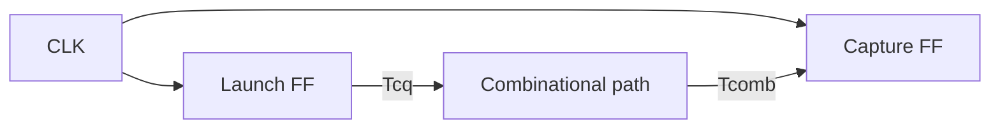

<ChapterHeader number="09" />

# Timing Constraints & STA

같은 경로를 max-delay setup과 min-delay hold로 따로 검사합니다.

선수 지식: D FF, clock-to-Q, 조합논리 지연입니다.

- Launch/capture edge와 skew의 부호를 명시할 수 있습니다.
- Setup/hold slack을 ns 단위로 각각 계산할 수 있습니다.
- Critical path와 모델이 다루지 않는 조건을 설명할 수 있습니다.

<!-- Source: Harris & Harris, DDCA, 2nd ed., Ch. 3, sequential timing. Equations use skew=capture arrival−launch arrival; uncertainties are nonnegative margins. -->

---

# Register-to-register Timing Path

- Setup: launch의 **이번 상승 에지**에서 capture의 **다음 상승 에지**까지입니다.
- Hold: launch와 capture의 **같은 번호 상승 에지**를 비교합니다.
- Propagation/max delay는 가장 늦은 도착, contamination/min delay는 가장 빠른 도착에 사용합니다.

$$skew=t_{capture}-t_{launch}$$

> 모든 값은 ns입니다. 동일 주파수·동일 상승 에지·단일 cycle의 단순 교육 모델입니다.

---

# Setup: Latest Arrival

Launch clock 도착을 시간 0으로 둡니다. $U_s\ge0$는 setup uncertainty입니다.

$$
\begin{aligned}
Arrival_{max}&=T_{cq,max}+T_{comb,max}\\
Required_s&=T_{clk}+skew-T_{setup}-U_s\\
Slack_s&=Required_s-Arrival_{max}
\end{aligned}
$$

- Slack ≥ 0: 이 모델에서 setup 조건을 충족합니다.
- Slack < 0: capture가 요구하는 시간보다 늦습니다.
- **Critical path:** 여기서는 setup slack이 가장 작은 경로입니다.

> Setup PASS만으로 hold, CDC, reset timing까지 검증된 것은 아닙니다.

---

# Setup Worked Example

| Parameter | Value | Parameter | Value |
| --- | --- | --- | --- |
| Tclk | 10.0 ns | Tcq_max | 1.0 ns |
| Tcomb_max | 7.0 ns | Tsetup | 1.0 ns |
| Skew | +0.5 ns | Setup uncertainty | 0.5 ns |

$$Slack_s=10+0.5-(1+7+1+0.5)=\boxed{1.0\;ns}$$

Arrival=8.0 ns, required=9.0 ns입니다.

주어진 나머지 값에서 최소 period는 9.0 ns이므로 $f_{max}\approx111.1\;MHz$입니다.

> 이는 이 경로의 setup 한계입니다. 다른 경로, hold, clock 파형과 corner를 포함한 회로 전체 한계가 아닙니다.

---

# Hold: Earliest Arrival

$U_h\ge0$는 hold uncertainty입니다. Setup의 max 지연을 재사용하지 않습니다.

$$
Slack_h=T_{cq,min}+T_{comb,min}-(T_{hold}+skew+U_h)
$$

예: $T_{cq,min}=0.2$, $T_{comb,min}=0.3$, $T_{hold}=0.2$, skew=+0.4, $U_h=0.1$ ns입니다.

$$Slack_h=0.2+0.3-(0.2+0.4+0.1)=\boxed{-0.2\;ns}$$

너무 빨리 도착하므로 hold violation입니다. Period를 늘려도 이 식은 변하지 않습니다.

> Min path에 지연을 추가하면 hold 개선이 가능하지만 setup에 미치는 영향도 다시 검사해야 합니다.

---

# Skew & Uncertainty

| Change | Setup slack | Hold slack |
| --- | --- | --- |
| Skew가 +0.5 ns 증가 | +0.5 ns | −0.5 ns |
| Setup uncertainty 증가 | 감소 | 이 식에서 직접 영향 없음 |
| Hold uncertainty 증가 | 이 식에서 직접 영향 없음 | 감소 |
| Period 증가 | 증가 | 동일 edge 모델에서 변화 없음 |

Positive skew는 capture clock이 늦게 도착한다는 뜻입니다.

이 단순식은 generated clock, multicycle, OCV, 다른 edge 관계, 복합 clock waveform을 일반화하지 않습니다.

> 실제 STA에서는 제약, 라이브러리 corner, parasitic, clock path와 uncertainty 모델을 함께 검토합니다.

---
routeAlias: lab-timing
---

# Setup Timing Simulator

기본값에서 skew를 −0.5 ns와 −0.6 ns로 바꿔 경계를 비교하세요.

<SetupTimingSimulator />

---

# Check Your Timing

1. 기본값 Tclk=10, Tcq=1, Tcomb=7, Tsetup=1, U=0.5 ns에서 skew=−0.5 ns이면 slack은?
2. 같은 조건에서 skew=−0.6 ns이면?
3. Hold violation을 period 증가만으로 해결할 수 있나요?

**검산:** 0 ns, 경계 PASS / −0.1 ns, VIOLATION / 이 동일 edge 모델에서는 불가능합니다.

여유 0은 강인한 설계를 뜻하지 않습니다. 공정·전압·온도 및 분석 오차는 별도 모델링과 margin이 필요합니다.

