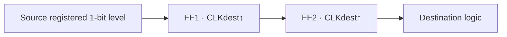

<ChapterHeader number="10" />

# Metastability & Clock Domain Crossing

비동기 경계에서는 시간뿐 아니라 전달 프로토콜도 설계합니다.

선수 지식: FF의 setup/hold, state trace, clock domain입니다.

- Metastability 발생 가능성과 resolution time을 설명할 수 있습니다.
- 2-FF synchronizer가 보호하는 신호와 한계를 구분할 수 있습니다.
- Pulse·multi-bit·연속 stream에 적합한 CDC 방식을 고를 수 있습니다.

<!-- Sources: R. Ginosar, Metastability and Synchronizers: A Tutorial, IEEE Design & Test, 2011, https://ran.net.technion.ac.il/files/2016/06/MetastabilitySynchronizersTutorialIEEEDT2011.pdf ; Intel/Altera Design Recommendations, metastability analysis, https://www.intel.com/programmable/technical-pdfs/683323.pdf . No process parameters or quantitative reliability estimates assumed. -->

---

# Metastability Is an Analog Event

입력이 sampling aperture 근처에서 바뀌면 FF 내부가 안정된 0/1로 빠르게 결정되지 않을 수 있습니다.

- Metastable 상태는 새로운 논리값이 아니라 **결정 지연의 아날로그 현상**입니다.
- 최종적으로 0 또는 1로 해소되지만, 유한한 시간 안의 해소를 절대 보장하지 못합니다.
- RTL의 X는 실제 metastable 전압이나 통계 분포를 재현하지 않습니다.

비동기 버튼이 동기 clock과 무관하게 바뀌면 setup/hold 관계를 항상 만족시킬 수 없습니다. Synchronizer는 실패 확률을 줄이는 장치입니다.

---

# Two-FF Synchronizer

- FF1 출력이 해소될 시간을 두고 FF2가 다시 샘플합니다.
- FF1과 FF2 사이에는 조합논리를 넣지 않고 지연을 작게 유지합니다.
- 목적지 기능 논리는 FF2 출력만 사용합니다. FF1을 분기해 사용하지 않습니다.
- 입력 level은 충분히 오래 유지되어야 하며 짧은 pulse는 놓칠 수 있습니다.

> 단일 bit 제어 level용 구조입니다. Multi-bit 데이터 정합성을 보장하지 않습니다.

---

# An Illustrative Synchronizer Trace

<LocalDiagram src="cdc.svg" alt="An asynchronous transition near destination edge E1 may leave FF1 uncertain; it resolves to one before E2 and FF2 samples one at E2 in this possible scenario" />

한 가능한 경우: E1 근처에서 입력이 변하고 FF1이 1로 해소되어 E2에서 FF2가 1을 받습니다.

다른 경우에는 E1에서 이전 값 0을 잡아 FF2의 변화가 더 늦을 수 있습니다.

> 도식은 개념 설명용이며 아날로그·SPICE 파형이 아닙니다. 고정 latency나 완전한 안전성을 보장하는 예가 아닙니다.

---

# MTBF: Probability, Not Certainty

개념적인 synchronizer 모델의 관계는 다음과 같습니다.

$$
MTBF\propto\frac{e^{T_{res}/\tau}}{f_{dest}\,f_{toggle}}
$$

- $T_{res}$: FF1의 해소에 허용한 시간입니다.
- $\tau$와 비례상수는 소자·회로·조건에 의존하며 검증된 값이 필요합니다.
- 목적지 clock 또는 입력 toggle 빈도가 높으면 위험 기회가 늘어납니다.
- $T_{res}$가 늘면 이 모델에서 MTBF가 지수적으로 증가합니다.

> 공정 상수를 가정해 임의의 MTBF 숫자를 만들지 않습니다. 전체 시스템의 여러 CDC 위험도 합산해야 합니다.

---

# Pulse & Multi-bit Transfer

| Transfer | Suitable approach | Requirement |
| --- | --- | --- |
| 오래 유지되는 1-bit level | Synchronizer chain | 충분한 안정 시간 |
| 짧은 event pulse | Toggle 또는 handshake | event 사이 간격·ack 규칙 |
| 여러 bits의 한 데이터 | Bundled-data handshake | data를 ack까지 유지, capture timing 확인 |
| 지속적인 data stream | Async FIFO | pointer CDC·full/empty 검증 |

Binary 0111→1000을 bit마다 독립 동기화하면 0000 같은 중간 조합을 받을 수 있습니다.

Gray counter는 한 번의 **인접 증가**에 한 bit만 바뀝니다. FIFO pointer에는 각 bit의 동기화와 bus-skew/max-delay 제약이 함께 필요합니다.

---

# Check Your Crossing

1. 2-FF 앞의 2 ns pulse를 period 10 ns의 목적지에서 반드시 받나요?
2. 8-bit bus의 각 bit에 2-FF를 두면 원자적 전달이 되나요?
3. Gray encoding만 적용하면 CDC 검증이 끝나나요?

**검산:** 모두 아닙니다.

Pulse는 누락될 수 있고, bus는 bits별 latency 차이로 손상될 수 있습니다. Gray도 source 전이, 동기화, 물리 제약, 소비 방식까지 검증해야 합니다.

