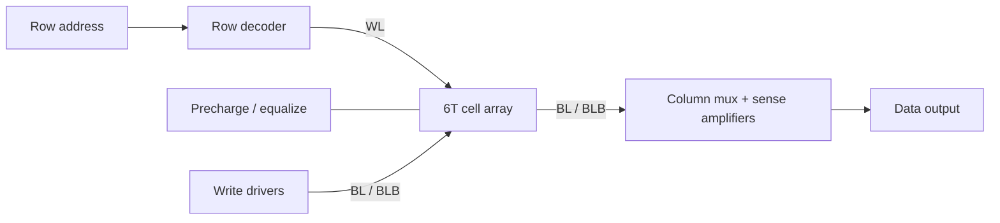

<ChapterHeader number="12" />

# SRAM Memory

Cell의 피드백, bitline 동작, array 수준의 안정성을 연결합니다.

선수 지식: inverter, latch, MOS의 이상적 switch 모델입니다.

- 6T cell의 4개 inverter 소자와 2개 access NMOS를 식별할 수 있습니다.
- Hold/read/write와 precharge·sense·write driver를 구분할 수 있습니다.
- SNM·writeability·Vmin과 단순 array yield 가정을 설명할 수 있습니다.

<!-- Sources: Weste & Harris, CMOS VLSI Design, 4th ed., SRAM chapter; D. Harris, E158 Lecture 11: Memory, https://pages.hmc.edu/harris/class/e158/01/lect11.pdf . All drawings original; symbolic educational model; no PDK/device dimensions or validated electrical simulation. -->

---

# Six-transistor Bitcell

<LocalDiagram src="images/sram-6t.svg" alt="Six transistor SRAM: left CMOS inverter is driven by QB and outputs Q; right inverter is driven by Q and outputs QB. Two access NMOS controlled by WL connect Q to BL and QB to BLB. PMOS sources connect to VDD, NMOS sources to VSS." tall />

4T = cross-coupled CMOS inverters, 2T = access NMOS입니다. Bulk 연결은 생략했습니다. 기호 수준 교육 회로이며 소자 비율·치수·전압값은 가정하지 않습니다.

---

# Hold & Read

Q=0, QB=1을 저장한 경우입니다. BL/BLB는 complementary bitlines입니다.

| Phase | WL | BL / BLB | Cell behavior |
| --- | --- | --- | --- |
| Hold | 0 | cell에서 격리 | 전원이 유지되면 피드백으로 저장합니다. |
| Precharge/equalize | 0 | 둘 다 VDD로 충전 | 차동 읽기를 준비합니다. |
| Read develop | 1 | BL↓, BLB≈VDD | BL → access → pull-down 경로로 방전합니다. |
| Sense / finish | 1→0 | 작은 차이를 증폭 | 출력 latch 후 WL을 내립니다. |

Read 중 낮은 Q가 일시적으로 올라갈 수 있습니다. 과도하면 **read disturb**로 저장값이 바뀔 수 있습니다.

> SRAM은 전원 유지 중 refresh가 필요 없지만 volatile입니다. DRAM은 charge를 저장하며 refresh가 필요합니다.

---

# Write & Conceptual Timing

<LocalDiagram src="images/sram-timing.svg" class="compact" alt="Read: precharge bitlines with WL low, disable precharge, raise WL to develop a differential, then sense. Write Q=0: drive BL low and BLB high before raising WL, lower WL before releasing drivers." />

- Q←0 write: driver가 BL=0, BLB=1을 먼저 설정한 뒤 WL을 올립니다.
- Q←1 write: BL=1, BLB=0으로 설정합니다.
- WL을 내린 뒤 driver를 해제합니다. Precharge와 write drive의 충돌을 피합니다.

> Illustrative phase 순서입니다. 실제 pulse width·sense 시점·non-overlap은 회로 조건으로 검증해야 합니다.

---

# Stability Is More Than One Number

| Metric | What it asks |
| --- | --- |
| Hold SNM | WL=0인 보존 상태에서 얼마나 noise를 견디나요? |
| Read SNM | read bias에서 read disturb를 얼마나 견디나요? |
| Writeability | 제한된 write pulse 동안 저장값을 바꿀 수 있나요? |

SNM은 두 inverter의 voltage-transfer 특성으로 만드는 butterfly 도형에 들어가는 최대 정사각형 변으로 설명할 수 있습니다.

Read assist는 disturb를 줄이고, write assist는 기존 상태를 뒤집기 쉽게 만듭니다. 다른 mode와 신뢰성의 trade-off를 확인해야 합니다.

> Hold SNM, read SNM, dynamic write margin은 같은 지표가 아닙니다. 보편적인 SNM·Vmin·cell ratio 숫자는 없습니다.

---

# Array & Peripheral Circuits

WL은 한 행의 cell을 선택하고, column 경로는 읽거나 쓸 bit를 선택합니다.

Cell이 정상이어도 decoder, sense amplifier, bitline 지연 또는 배선 때문에 macro가 실패할 수 있습니다.

> Vmin은 지정한 주파수·온도·불량 기준·assist 등에서 정하는 동작 한계입니다. Cell 하나의 정적 수치로 array Vmin을 단정하지 않습니다.

---

# From Bit Failure to Array Yield

각 bit의 실패확률이 **독립이며 모두 p**, redundancy/ECC가 없다고 가정합니다.

$$Y=(1-p)^N\approx e^{-Np}\qquad(p\ll1)$$

교육용 가상 예: N=1,024 bits, p=$10^{-4}$이면

$$Y=(0.9999)^{1024}\approx0.90266=90.27\%$$

p를 $10^{-5}$로 낮추면 같은 N에서 약 98.98%입니다.

- 실제 공통 전압·공정 변화는 bit 간 상관관계를 만듭니다.
- Peripheral failure, repair, redundancy, ECC는 이 단순식에 포함하지 않았습니다.

> 이 확률은 연습용 가정이며 특정 공정의 측정 결과가 아닙니다.

---

# Check Your Memory Model

1. Q=0 read에서 어느 bitline이 먼저 내려가나요?
2. 왜 precharge 동안 WL을 낮게 두나요?
3. Bit failure가 서로 상관되어도 $(1-p)^N$을 그대로 쓰나요?

**검산:** BL입니다 / cell을 bitline 준비 과정에서 격리합니다 / 아닙니다.

Cell → read/write peripheral → array의 세 수준을 구분하고, 각 단계의 가정과 실패 조건을 검증해야 합니다.

